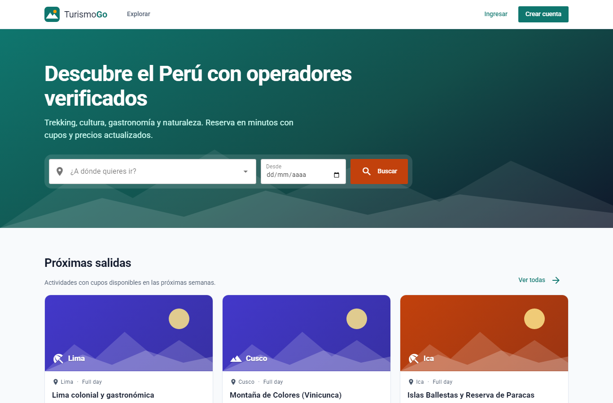
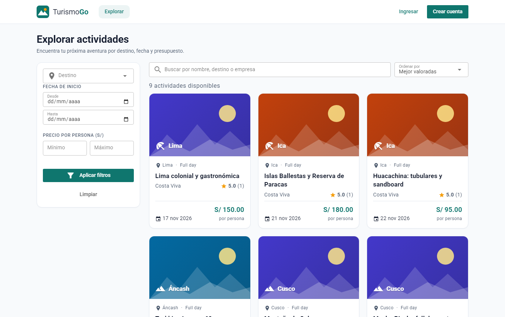
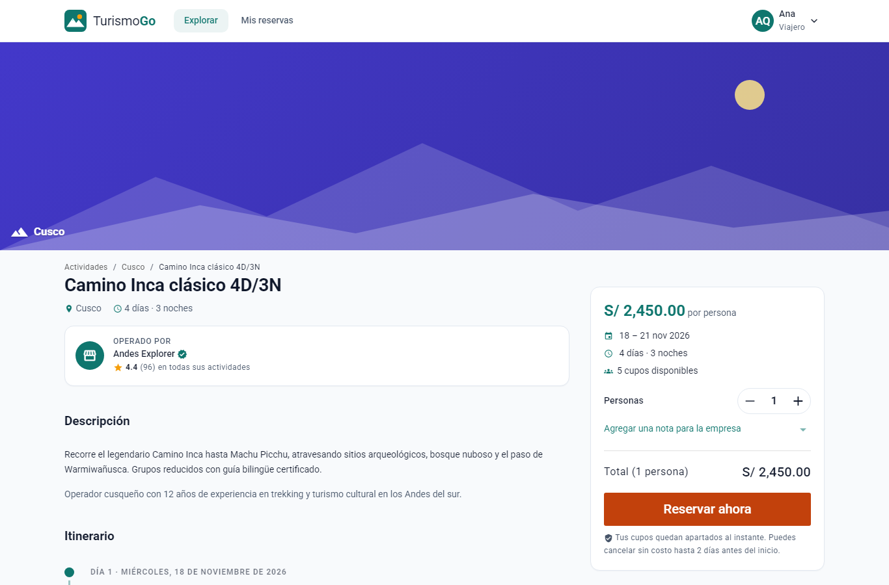
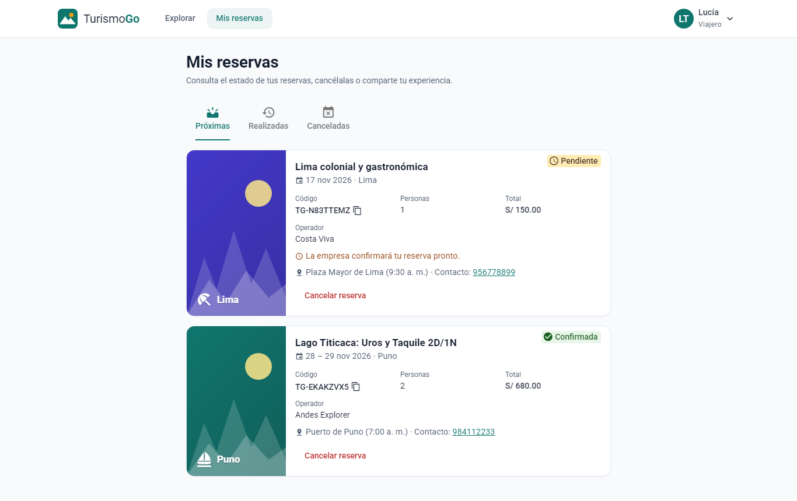
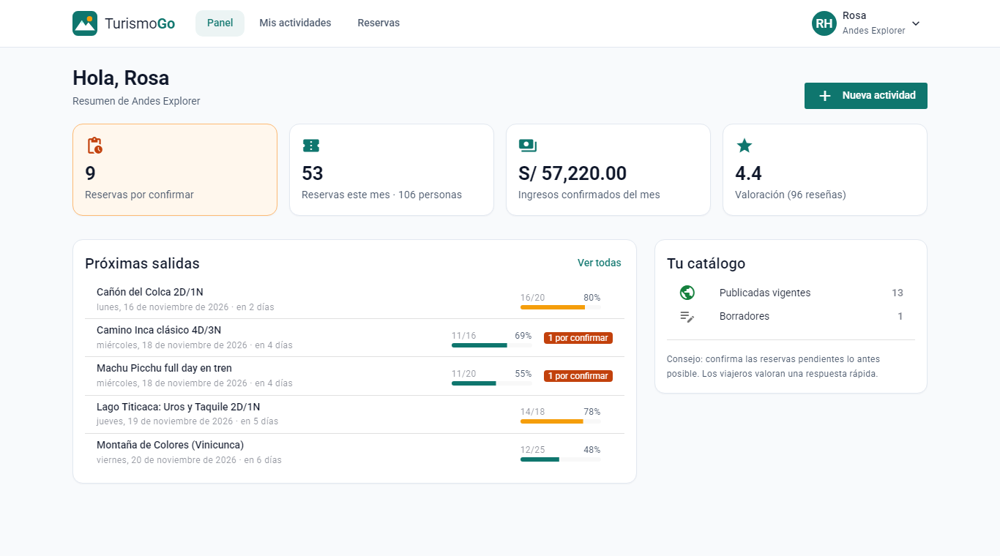
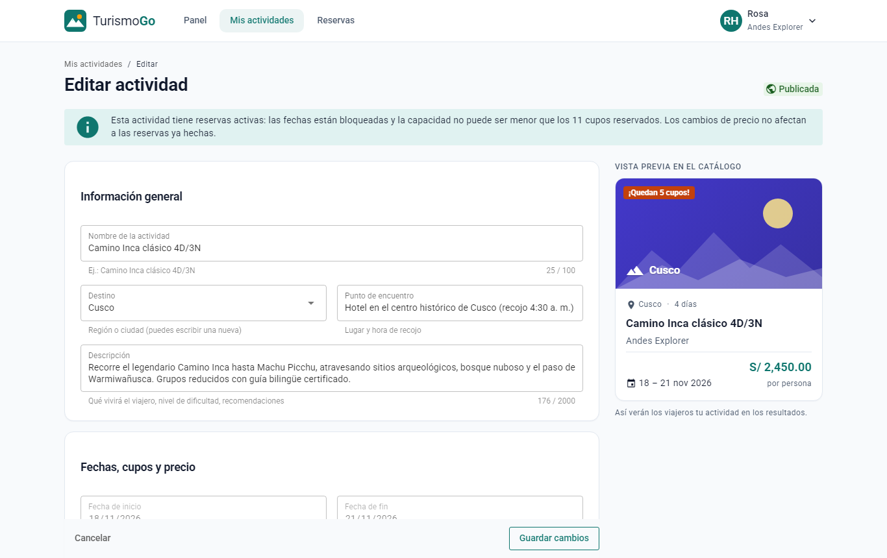
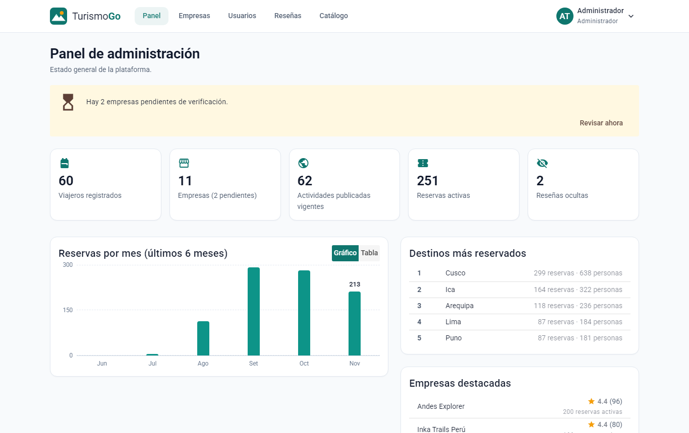
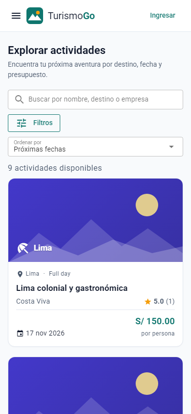

# TurismoGo

Marketplace de actividades turísticas en Perú. Las empresas de turismo publican sus salidas (trekking, tours culturales, excursiones) y los viajeros las exploran, reservan y reseñan. Un equipo administrador verifica a las empresas y modera el contenido.

Proyecto full stack con **ASP.NET Core 10** (API REST), **Vue 3 + Quasar** (SPA) y **SQL Server**.



## Contenido

- [Funcionalidades](#funcionalidades)
- [Capturas](#capturas)
- [Tecnologías](#tecnologías)
- [Arquitectura](#arquitectura)
- [Puesta en marcha](#puesta-en-marcha)
- [Cuentas de demostración](#cuentas-de-demostración)
- [Configuración](#configuración)
- [Pruebas y verificación](#pruebas-y-verificación)
- [Resumen de la API](#resumen-de-la-api)
- [Despliegue en producción](#despliegue-en-producción)
- [Hoja de ruta](#hoja-de-ruta)
- [Licencia](#licencia)

## Funcionalidades

**Viajeros**
- Catálogo público (no exige cuenta): búsqueda por texto, destino, fechas y precio; orden por fecha, precio o valoración; filtros que se guardan en la URL.
- Detalle de cada actividad: itinerario día por día, qué incluye y qué no, punto de encuentro, operador verificado y reseñas con su distribución.
- Reservas con cupos en tiempo real, total calculado por el servidor y código de reserva. Se puede cancelar sin costo hasta 2 días antes del inicio.
- "Mis reservas", con las próximas, las realizadas y las canceladas. Solo quien completó la actividad puede reseñarla, y una sola vez.

**Empresas de turismo**
- Registro con RUC. La empresa queda pendiente hasta que un administrador la verifica, y solo entonces puede publicar.
- Panel con indicadores: reservas por confirmar, reservas e ingresos del mes, valoración y ocupación de las próximas salidas.
- Gestión de actividades: borrador, publicar, retirar, duplicar y cancelar (lo que cancela también las reservas, con un motivo). Las fechas quedan bloqueadas si hay reservas activas.
- Reservas recibidas: confirmar o rechazar con motivo y exportar la lista de participantes en CSV, que sirve como manifiesto de pasajeros.

**Administración**
- Indicadores, gráfico de reservas por mes, destinos más reservados y empresas destacadas.
- Verificación y suspensión de empresas, suspensión de cuentas (el acceso se corta en el acto) y moderación de reseñas.

**Calidad y seguridad**
- Contraseñas con hash PBKDF2, autenticación JWT, autorización por rol y por propiedad del recurso, y límite de intentos en el login.
- Errores en formato ProblemDetails con mensajes en español y sin exponer detalles internos.
- Control de concurrencia optimista: dos reservas simultáneas no pueden sobrevender cupos.
- Interfaz responsive y accesible: zoom permitido, navegación por teclado, textos alternativos y estados de carga, vacío y error.

## Capturas

| Catálogo con filtros | Detalle y reserva |
|---|---|
|  |  |

| Mis reservas | Panel de empresa |
|---|---|
|  |  |

| Formulario de actividad | Panel de administración |
|---|---|
|  |  |

<p align="center"></p>

## Tecnologías

| Capa | Tecnologías |
|---|---|
| Backend | .NET 10 (LTS), ASP.NET Core Web API, Entity Framework Core 10, FluentValidation, JWT Bearer, OpenAPI y Swagger UI |
| Base de datos | SQL Server 2022 (migraciones de EF Core) |
| Frontend | Vue 3, Quasar 2, Vue Router, Pinia, Axios, Vite |
| Pruebas | xUnit, WebApplicationFactory, SQLite en memoria y Vitest |
| Herramientas | Docker Compose (base de datos local), ESLint 9 y Prettier |

## Arquitectura

```
TurismoWeb/
├── backend/
│   ├── src/
│   │   ├── TurismoGo.Domain/          Entidades, enums y reglas de negocio (sin dependencias)
│   │   ├── TurismoGo.Application/     Casos de uso, DTOs, validaciones y servicios
│   │   ├── TurismoGo.Infrastructure/  EF Core, migraciones, hash de contraseñas y datos demo
│   │   └── TurismoGo.Api/             Controladores, JWT, manejo de errores y OpenAPI
│   └── tests/TurismoGo.Tests/         Pruebas de dominio, servicios e integración HTTP
├── frontend/                          SPA en Vue 3 + Quasar
│   └── src/ (pages, components, layouts, stores, services, utils)
├── docs/                              Requisitos, plan de mejoras y capturas
├── scripts/                           Verificación local en un solo comando
└── docker-compose.yml                 SQL Server para desarrollo
```

Las dependencias van hacia el dominio: `Api → Infrastructure → Application → Domain`. Las reglas importantes (cupos, cancelación, transiciones de estado) viven en las entidades y tienen pruebas unitarias.

## Puesta en marcha

### Requisitos previos

- [.NET SDK 10](https://dotnet.microsoft.com/download)
- [Node.js](https://nodejs.org/) 22.22 o superior (se recomienda la 24)
- [Docker Desktop](https://www.docker.com/products/docker-desktop/), para la base de datos. También sirve una instancia propia de SQL Server; ver [Configuración](#configuración).

### Opción rápida en Windows

Haz doble clic en **`iniciar.bat`**, en la raíz del proyecto. El script:
1. Comprueba los requisitos.
2. Inicia Docker si hace falta.
3. Levanta la base de datos.
4. Abre la API y el sitio web en sus propias ventanas.

Al final, el navegador se abre en http://localhost:9000. Para apagarlo todo, ejecuta **`detener.bat`**: los datos se conservan.

### Opción manual (cualquier sistema operativo)

#### 1. Base de datos

```bash
cp .env.example .env        # opcional: cambia la contraseña o el puerto
docker compose up -d        # SQL Server en localhost:14333
```

#### 2. API

```bash
cd backend
dotnet run --project src/TurismoGo.Api
```

En el entorno de desarrollo, al iniciar se aplican las migraciones y se cargan los datos de demostración automáticamente.

- API: http://localhost:5259
- Documentación interactiva (Swagger): http://localhost:5259/swagger
- Estado del servicio: http://localhost:5259/health

#### 3. Frontend

```bash
cd frontend
npm install
npm run dev                 # http://localhost:9000
```

## Cuentas de demostración

Solo existen en el entorno de desarrollo.

| Rol | Correo | Contraseña |
|---|---|---|
| Administrador | admin@turismogo.pe | Admin2026! |
| Empresa verificada | ventas@andesexplorer.pe | Demo2026! |
| Empresa verificada | reservas@costaviva.pe | Demo2026! |
| Empresa pendiente de verificación | contacto@amazoniaviva.pe | Demo2026! |
| Viajero | ana.quispe@correo.pe | Demo2026! |
| Viajero (con una reseña pendiente) | lucia.torres@correo.pe | Demo2026! |

## Configuración

**Backend** (`appsettings.json`, variables de entorno con `__` como separador, o `dotnet user-secrets`):

| Clave | Descripción |
|---|---|
| `ConnectionStrings__TurismoGo` | Cadena de conexión a SQL Server. |
| `Jwt__Clave` | Clave de firma de los tokens, de al menos 32 caracteres. **Obligatoria en producción.** |
| `Jwt__MinutosExpiracion` | Duración de la sesión en minutos (por defecto, 480). |
| `Cors__OrigenesPermitidos__0` | Origen del frontend, por ejemplo `https://turismogo.pe`. |
| `ReglasNegocio__DiasMinimosCancelacion` | Días de anticipación para cancelar sin costo (por defecto, 2). |
| `ReglasNegocio__MaxPersonasPorReserva` | Máximo de personas por reserva (por defecto, 20). |
| `Inicializacion__AplicarMigraciones` | Aplica las migraciones al iniciar (activo en desarrollo). |
| `Inicializacion__SembrarDatosDemo` | Carga los datos de demostración si la base está vacía (solo desarrollo). |
| `Inicializacion__AdminCorreo` / `Inicializacion__AdminPassword` | Crean el primer administrador si todavía no existe ninguno. |

**Frontend** (archivo `frontend/.env`; ver `frontend/.env.example`):

| Variable | Descripción |
|---|---|
| `TG_API_URL` | URL base de la API (por defecto, `http://localhost:5259`). |

## Pruebas y verificación

```bash
# Backend: dominio, servicios e integración HTTP
cd backend && dotnet test

# Frontend: utilidades (fechas, moneda, validaciones)
cd frontend && npm test
```

Verificación completa (compilación, pruebas, auditoría de dependencias, lint y build de producción) en un solo comando, sin servicios externos:

```bash
sh scripts/verificar.sh                                        # Linux, macOS o Git Bash
powershell -ExecutionPolicy Bypass -File scripts/verificar.ps1  # Windows
```

## Resumen de la API

La documentación completa está en Swagger (`/swagger`). Para probar los endpoints protegidos, inicia sesión en `/api/auth/login` y pega el token en "Authorize".

| Área | Endpoints principales | Acceso |
|---|---|---|
| Autenticación | `POST /api/auth/login`, `POST /api/auth/registro/turista`, `POST /api/auth/registro/empresa`, `GET /api/auth/me` | Público / sesión |
| Cuenta | `PUT /api/cuenta/perfil`, `PUT /api/cuenta/password` | Sesión |
| Catálogo | `GET /api/actividades`, `GET /api/actividades/{id}`, `GET /api/actividades/{id}/resenas`, `GET /api/destinos` | Público |
| Viajero | `POST /api/reservas`, `GET /api/mis/reservas`, `POST /api/reservas/{id}/cancelar`, `POST /api/actividades/{id}/resenas` | Turista |
| Empresa | `/api/empresa/perfil`, `/api/empresa/panel`, `/api/empresa/actividades` (CRUD y acciones), `/api/empresa/reservas` y `.../participantes.csv` | Empresa |
| Administración | `/api/admin/resumen`, `/api/admin/empresas`, `/api/admin/usuarios`, `/api/admin/resenas` | Admin |

Los errores siguen el formato [ProblemDetails](https://www.rfc-editor.org/rfc/rfc9457) (`400`, `401`, `403`, `404`, `409`, `422` y `429`), con mensajes en español y errores por campo en camelCase.

## Despliegue en producción

- Define `ASPNETCORE_ENVIRONMENT=Production`, `ConnectionStrings__TurismoGo`, `Jwt__Clave` (un secreto propio) y `Cors__OrigenesPermitidos__0`.
- Aplica las migraciones de forma controlada: `dotnet ef database update -p src/TurismoGo.Infrastructure -s src/TurismoGo.Api` (la herramienta se instala con `dotnet tool restore`).
- Usa `Inicializacion__AdminCorreo` e `Inicializacion__AdminPassword` solo en el primer arranque, para crear el administrador.
- Frontend: `npm run build` genera `frontend/dist/spa`. Como el router usa el modo *history*, el servidor web debe redirigir las rutas desconocidas a `index.html`.

## Hoja de ruta

- Pagos en línea mediante una pasarela local.
- Notificaciones por correo (confirmación, recordatorio y cancelación).
- Subida de imágenes con almacenamiento propio.
- Calendario de salidas recurrentes para una misma actividad.

El plan de mejoras completo y el diagnóstico inicial están en [docs/PLAN_DE_MEJORAS.md](docs/PLAN_DE_MEJORAS.md). Los requisitos y las reglas de negocio están en [docs/requisitos.md](docs/requisitos.md).

## Licencia

Distribuido bajo la licencia MIT. Consulta el archivo [LICENSE](LICENSE).

## ¿Te gustó el proyecto?

Si este proyecto te resultó útil o te gustó, puedes regalarle una ⭐ al repositorio. Ayuda a que más personas lo encuentren.
